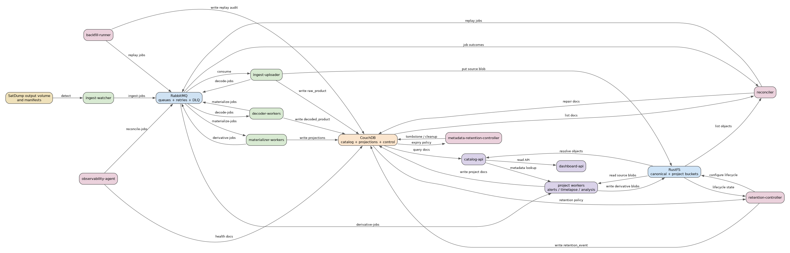
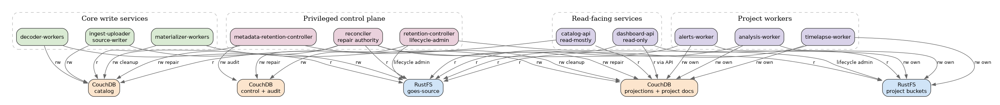

# System Overview

## Purpose

This platform replaces the current filesystem-first model with a containerized ingest and processing plane.

It is designed to:

- ingest SatDump outputs without relying on host-side scripts
- store canonical blobs in RustFS
- store evolving metadata and decoded views in CouchDB
- execute downstream work through queue-driven services
- support dashboards, alerts, timelapses, and future project containers from the same source inventory

## Major Planes

| Plane | Components | Responsibility |
| --- | --- | --- |
| Ingest plane | `ingest-watcher`, `ingest-uploader` | discover incoming files, classify them, upload blobs, create canonical metadata |
| Metadata plane | `CouchDB`, decoder/materializer services | store product docs, decoded docs, projections, lineage, retention state |
| Object plane | `RustFS` | store canonical raw blobs and per-project derivative objects |
| Execution plane | `RabbitMQ`, workers | run decoding, materialization, derivative generation, reconciliation, and backfills |
| Access plane | `catalog-api`, `dashboard-api` | expose stable internal and browser-facing read interfaces |
| Control plane | retention/reconciliation/observability services | enforce policy, detect drift, expose system health |

## Service Topology

Privilege separation for the same architecture is documented separately:

## End-to-End Flow

1. `ingest-watcher` observes SatDump output volumes or receives a pushed manifest.
2. It emits ingest jobs to the queue.
3. `ingest-uploader` fingerprints the file, computes canonical object keys, uploads the blob to `goes-source`, and writes a `raw_product` document.
4. `decoder-workers` decode supported product families and write `decoded_product` documents.
5. `materializer-workers` build projections such as `station_view`, dashboard summaries, and alert-friendly summaries.
6. Project workers read canonical blobs and metadata, produce derivatives, and write them into project-specific buckets and documents.
7. Retention and reconciliation services continuously validate lifecycle policy and state consistency.

## Deployment Shape

Everything in this architecture runs in containers. The host only provides:

- container runtime
- mounted SatDump input volumes
- mounted persistent volumes for RustFS/CouchDB data
- network and secret injection

No host-local Python scripts are part of the steady-state design.
